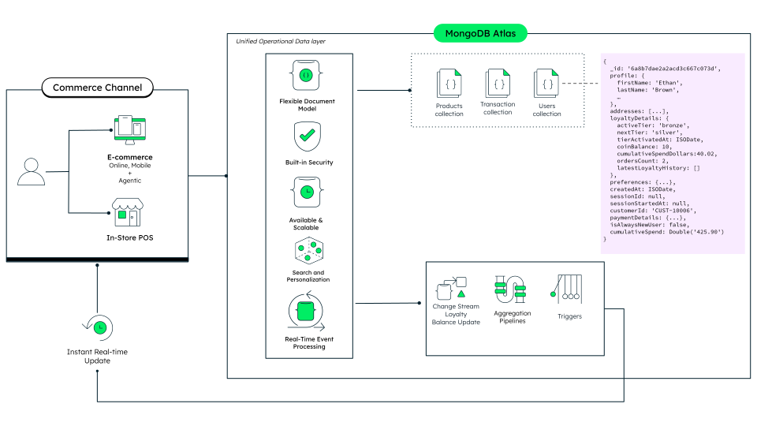
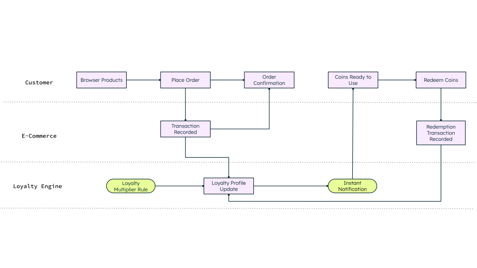

# Leafy Loyalty Store – Instant Loyalty Rewards with MongoDB

This README helps developers understand the purpose, structure, and deployment process of this Demo App.

---

## Overview

<table>
  <tr>
    <td width="300">
      <!-- TODO: add hero image at docs/images/instant_loyalty.png -->
      
    </td>
    <td>
      This demo showcases the <b>Leafy Loyalty Store</b>, an e-commerce app built on <b>MongoDB</b> to demonstrate <b>instant loyalty</b>: rewards that are credited, visible, and usable the moment a purchase is complete.<br><br>
      Many loyalty platforms still credit rewards through overnight batch jobs—after checkout, the shopper sees an unchanged balance, can't spend what they just earned, and has no confirmation the purchase counted. This demo shows the opposite: coins land at checkout, tier progress updates live, and the fresh balance can go straight into the next purchase.<br><br>
      MongoDB Atlas acts as a <b>single operational data layer</b>: orders, payments, loyalty rules, the customer's balance, and its ledger live in one place—kept <b>correct</b> with multi-document transactions, <b>instant</b> with change streams, and <b>easy to change</b> because promotions are data, not code releases.
    </td>
  </tr>
</table>

---

## Discover in this Demo:

- **Rewards at the moment of purchase**
  Coins earned, tier progress, and the loyalty ledger update the instant an order is placed. A **Behind the scenes** panel on the confirmation page walks through every MongoDB operation, with **Learn more** modals showing the real documents.

- **Coins as a payment method**
  Shoppers can pay with coins, card, or both (hybrid payment). Each tier gives coins a different redemption value, and a declined card is recorded as data without awarding any coins.

- **Promotions are data, not releases**
  Tiers, earning rates, and campaign multipliers live in a configuration document managed from an **Admin** backoffice view. Switch on a 3x campaign and the very next order earns triple coins—no deployment, no engineering ticket.

- **The right guarantee for the right job**
  An order is one document, so a single insert is already atomic. Only the customer's balance and its ledger entries must never disagree, so those two writes share a **MongoDB multi-document transaction**: both commit, or neither does.

- **Pushed, not polled**
  **Change streams** notify the app the moment a committed balance or tier change lands—the header updates and tier-up celebrations play with no polling and no separate message broker.

- **Coins drive the next purchase**
  Right after earning, an **aggregation pipeline** runs against the freshly committed balance to suggest what the member could redeem for free or nearly free—turning the reward into the next sale.

---

## 🧩 Architecture Overview


| Component | Description |
|----------|-------------|
| **Frontend (Next.js)** | Delivers the store UI (persona selection, catalog, cart, checkout, confirmation, histories, profile) and proxies API calls to the backend through its own API routes. Includes built-in **Talk track** presenter material on every page. |
| **Backend (Fastify)** | Node.js API that owns the business logic: session/persona claiming, order placement, simulated payments, the loyalty engine (coins, tiers, multipliers), the redeem-candidates aggregation, and a change-stream feed that pushes loyalty updates to the browser. |
| **MongoDB Atlas** | Core operational data layer: `customers`, `products`, `orders`, `transactions`, `loyaltyHistory`, `loyaltyConfiguration`, `seedLoyaltyConfiguration`, and supporting collections. Balance + ledger writes are wrapped in a transaction; change streams push committed updates back to the app. |
| **Atlas Triggers (demo housekeeping)** | A database trigger prepares a fresh loyalty configuration for each demo session, and a scheduled trigger closes sessions left open for 8+ hours—keeping demo data clean and personas available. A real retailer would not need them. |

🗄️ Database & Modeling → See [docs/setup/collections/README.md](./docs/setup/collections/README.md) for setup instructions and insights into our data modeling strategy.

---

## 🗂 Folder Structure

```bash
retail-instant-loyalty/
├── frontend/               # Next.js store app (port 8080)
├── backend/                # Fastify API (port 8000)
├── docs/
│   ├── setup/              # collections (dataset), indexes, atlas-triggers
│   └── user-guide/         # demo walkthroughs per module
├── docker-compose.yml      # Orchestrates both services
├── Dockerfile.backend
└── Dockerfile.frontend
```

---

## 🐳 Getting Started – Run the Full Demo Locally

### 🔧 Prerequisites

- [MongoDB Atlas account](https://www.mongodb.com/cloud/atlas/register) (Free Tier works)
- [Demo dataset](./docs/setup/collections/README.md) – we provide a `mongodump` export of all collections, restored with a single `mongorestore` command (indexes and collection options included)
- [Index definitions](./docs/setup/indexes/README.md) – regular B-tree indexes only; created automatically by `mongorestore`
- [Atlas Triggers](./docs/setup/atlas-triggers/) – configure both triggers in your Atlas project (see the [Collections Setup Guide](./docs/setup/collections/README.md) for configuration notes):
  - [`retail_leafy_loyalty_customer_updated.js`](./docs/setup/atlas-triggers/retail_leafy_loyalty_customer_updated.js) – creates/cleans the per-session loyalty configuration
  - [`retail_leafy_loyalty_close_long_sessions.js`](./docs/setup/atlas-triggers/retail_leafy_loyalty_close_long_sessions.js) – closes sessions left open for 8+ hours
- Environment configuration files (`.env`) for each app, using the `.env.example` files as a template:
  - [backend](./backend/.env.example) – `MONGODB_URI`, `DATABASE_NAME` (we recommend `retail_leafy_loyalty`), `PORT`
  - [frontend](./frontend/.env.example) – backend URL
- Installed tools:
  - Docker + Docker Compose
  - Node.js v22 (only if running the apps without Docker)

---

### 🚀 Start Locally with Docker Compose

```bash
git clone https://github.com/mongodb-industry-solutions/retail-instant-loyalty.git
cd retail-instant-loyalty
docker compose up --build
```

> 📝 **Note:** Once the apps are running, go to [http://localhost:8080](http://localhost:8080) to use the store.
> The backend API listens on [http://localhost:8000](http://localhost:8000).

#### Common Commands

| Action                   | Command                      |
|--------------------------|------------------------------|
| Build & start            | `docker compose up --build`  |
| Start (no rebuild)       | `docker compose up -d`       |
| Stop all containers      | `docker compose down`        |
| View all logs            | `docker compose logs -f`     |
| View one service's logs  | `docker compose logs -f backend` |

#### Running Without Docker

| App      | Commands                                   |
|----------|--------------------------------------------|
| Backend  | `cd backend && npm install && npm run dev` |
| Frontend | `cd frontend && npm install && npm run dev`|

---

## 👨‍💻 Explore the Demo

Now that the app is running, pick a persona on the login screen and walk the full shopper journey. Use the available helpers to guide you:

- **Talk track** (in the header) – presenter material per page: how to demo it, the business value of instant loyalty, what MongoDB does behind the scenes, and why MongoDB
- **Admin** – the backoffice view of the loyalty rules (reward value, tier thresholds, promo campaigns)
- **Behind the scenes** panels and **Learn more** modals – the real MongoDB documents and operations behind each order

👉 Full walkthrough: [User Guide](./docs/user-guide/README.md) · [Instant Loyalty Module Guide](./docs/user-guide/modules/instant-loyalty/README.md)



---

## 🍃 Why MongoDB for Instant Loyalty

MongoDB Atlas gives retailers one operational data foundation for the whole loyalty journey—from purchase and reward to discovery and re-engagement—so loyalty stays instant, trustworthy, and easy to change.

### Key Advantages

- **One live customer view**
  A member's profile, preferences, coin balance, tier, and cumulative spend live together in a single customer document. The app renders the experience in one fetch—no joins across separate systems, no stale copies.

- **Flexible model, rules as data**
  Tiers, earning rates, and campaigns are documents, not code. New mechanics—date windows, category bonuses, new payment methods—are added as fields, with no schema migrations and no downtime.

- **Transactions where they matter**
  Most writes are naturally atomic because an order is one document. For the one place that needs more—the balance and its ledger—multi-document transactions make them commit together or not at all, so the balance can always be explained by its history.

- **Real-time event processing**
  Change Streams push committed balance and tier changes straight to the customer's app, filtered server-side, with no polling and no separate message broker. Atlas Triggers add event-driven automation on the same platform.

- **Personalization that stays operational**
  Aggregation pipelines compute on the fresh balance—like which products a customer can get free right now. Atlas Search and Vector Search are available on the same live data for discovery and semantic recommendations, with no separate engine to keep in sync.

- **Enterprise-grade scale and security**
  Built-in high availability and horizontal scaling keep programs responsive through peak events, while authentication, RBAC, and encryption protect some of a retailer's most sensitive customer data.

---

## 👥 Authors

### Lead Authors *(Use Case Ideation & Retail Implementation)*

- [**Rodrigo Leal**](https://www.linkedin.com/in/rodrigo-leal-5b240121/) – retail Field CTO

### Developers & Maintainers *(Technical Design & Implementation)*
- [**Abhinav Singh**](https://www.linkedin.com/in/abhinavsingh1009/) – Developer & Maintainer
- [**Angie Guemes**](https://www.linkedin.com/in/angelica-guemes-estrada/) – Developer & Maintainer

---

## Related Demo Content Package

[ITDM Blog: How Real-Time Rewards Drive 2.5x Higher Customer Spend](https://www.mongodb.com/company/blog/innovation/how-real-time-rewards-drive-2-5x-higher-customer-spend)

---

⭐ If you found this useful, consider giving the repo a star!

---

## MIT License

Copyright (c) 2026 MongoDB

Permission is hereby granted, free of charge, to any person obtaining a copy
of this software and associated documentation files (the "Software"), to deal
in the Software without restriction, including without limitation the rights
to use, copy, modify, merge, publish, distribute, sublicense, and/or sell
copies of the Software, and to permit persons to whom the Software is
furnished to do so, subject to the following conditions:

The above copyright notice and this permission notice shall be included in all
copies or substantial portions of the Software.

THE SOFTWARE IS PROVIDED "AS IS", WITHOUT WARRANTY OF ANY KIND, EXPRESS OR
IMPLIED, INCLUDING BUT NOT LIMITED TO THE WARRANTIES OF MERCHANTABILITY,
FITNESS FOR A PARTICULAR PURPOSE AND NONINFRINGEMENT. IN NO EVENT SHALL THE
AUTHORS OR COPYRIGHT HOLDERS BE LIABLE FOR ANY CLAIM, DAMAGES OR OTHER
LIABILITY, WHETHER IN AN ACTION OF CONTRACT, TORT OR OTHERWISE, ARISING FROM,
OUT OF OR IN CONNECTION WITH THE SOFTWARE OR THE USE OR OTHER DEALINGS IN
THE SOFTWARE.
