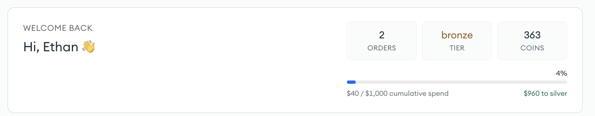

# Leafy Loyalty Store – User Guide

Welcome to the **Leafy Loyalty Store**, an interactive demo designed to showcase how retailers can deliver **instant loyalty rewards**—credited, visible, and usable the moment a purchase is complete—powered by **MongoDB Atlas**.

This guide walks you through the overall structure of the demo and provides an overview of each module.

---

## ✨ What Is the Leafy Loyalty Store?

The **Leafy Loyalty Store** is an e-commerce application built to demonstrate how MongoDB solves the problem of **delayed loyalty rewards**. Many loyalty platforms still credit rewards through overnight batch jobs: after checkout, the shopper sees an unchanged balance, can't spend what they just earned, and has no confirmation the purchase counted. This demo shows the opposite experience:

- **Instant recognition** – the reward is credited and visible the moment the purchase is complete.
- **Immediate usability** – new coins can go straight into the next purchase, alone or combined with a card (hybrid payment).
- **Live promotions** – bonus campaigns (e.g., a 3x multiplier) switch on and off in real time, with no code release.

All of it is powered by MongoDB Atlas as a **single operational data layer**: orders, payments, loyalty rules, the customer's balance, and its history live in one place—kept **correct** with multi-document transactions, **instant** with change streams, and **easy to change** because promotions are data, not releases.

---

# 📦 Modules Overview

The Leafy Loyalty Store currently includes one core module. The folder structure is designed so future modules (e.g., personalization, dynamic pricing) can be added as sibling folders under [`modules/`](./modules/).

---

## 1. Instant Loyalty

Walk a returning member through a full shopping journey—browse, cart, checkout, confirmation—and watch coins, tier progress, and the loyalty ledger update **in real time**, with a "Behind the scenes" panel that reveals the actual MongoDB operations at every step.

**Designed for:**
🛍️ Shoppers / loyalty members
📣 Marketing and loyalty teams
🧑‍💻 Retail IT teams

### Features
- Live loyalty snapshot (orders, tier, coin balance, progress to next tier) on every page
- Coins as a payment method, with hybrid coin + card checkout
- Promotion multipliers managed as configuration data from an Admin backoffice view
- Coins-balance-and-ledger writes wrapped in a MongoDB transaction; UI refreshed via change streams
- Built-in **Talk track** presenter material on every page

### Screenshot


### Module Documentation
👉 [Instant Loyalty Module README](./modules/instant-loyalty/README.md)

---

#  User Guide Modules

Each module lives in its own folder under [`modules/`](./modules/) with its own README, for example:

```
docs/user-guide/
├── README.md               ← you are here
└── modules/
    ├── instant-loyalty/    ← existing module
 (example)
    ├── dynamic-pricing/    ← future module
    └── personalization/    ← future module
```

---

# 🛠 Getting Started

To run the demo, follow the setup instructions in the repository:

- [Root README](../../README.md) – overview and app startup (Docker)
- [Collections Setup Guide](../setup/collections/README.md) – database import, modeling, and triggers
- [Indexes Setup Guide](../setup/indexes/README.md) – index configuration

---
