# 💰 Instant Loyalty Module – User Guide

The **Instant Loyalty** module demonstrates a loyalty program where rewards are **credited, visible, and usable at the moment of purchase**—instead of arriving after an overnight batch process. You will shop as a returning member, place an order, and watch coins, tier progress, and the loyalty ledger update in real time.

This guide explains how to navigate the demo and how to present each page effectively.

---

# 🚀 Getting to This Module

1. Start the app (see the [root README](../../../../README.md)) and open it in your browser.
2. You land on the **persona selection** page (`/login`). Selecting a persona **claims it and starts a demo session**—each persona can only be used by one session at a time, so if one was just taken, pick another.
3. Once a persona is selected you are taken to the store's landing page.

> 💡 **Presenter surfaces:** the header contains two links you will use throughout the demo:
> - **Talk track** – opens presenter material with four tabs: *How to demo this page* (context-aware per page), *Instant loyalty* (business value), *Behind the scenes* (architecture and MongoDB operations), and *Why MongoDB*.
> - **Admin** – opens the backoffice view of the loyalty settings (reward value, tier thresholds, and promo campaigns).

---

# 🎯 What You Can Do in This Module

- Shop as a loyalty member and see a **live loyalty snapshot** (orders, tier, coins, progress) on every page.
- See how many coins an order **will earn before placing it**, at the active campaign multiplier.
- **Pay with coins**, card, or both (hybrid payment)—each tier gives coins a different redemption value.
- Place an order and watch the reward **land instantly**, with a step-by-step **Behind the scenes** panel showing the real MongoDB operations.
- Explore the **loyalty ledger**, order history, and the member's single customer document.
- Change loyalty rules (campaign multipliers, tier thresholds) from the **Admin** view and see the effect on the very next order—no release needed.

---

# 👣 How to Demo This Module

Follow the shopper journey page by page. Each page's **Talk track → How to demo this page** tab contains the same steps with annotated screenshots.

---

## **1. Landing Page**

1. Start on the landing page as the demo member. Point out the **welcome card** with orders, tier, and coins, and the progress bar showing how much more cumulative spend is needed to reach the next tier.

   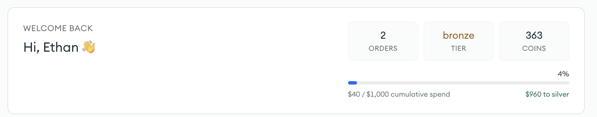

2. Call out the **promotion banner** at the top. It reflects the active campaign; the multiplier behind it is what gets applied to coins earned at checkout. Campaigns are configuration data that admins manage—not code that needs a release.

   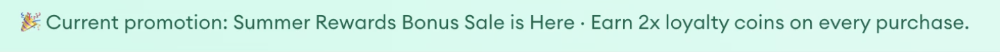

3. Scroll to **"More to explore"** and use the category pills to filter the catalog.

   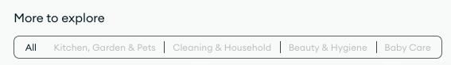

4. Click any product to open **Product details**. Show the store availability list, then expand **Product document** to reveal the full MongoDB document behind the page—a good moment to mention the flexible document model.

   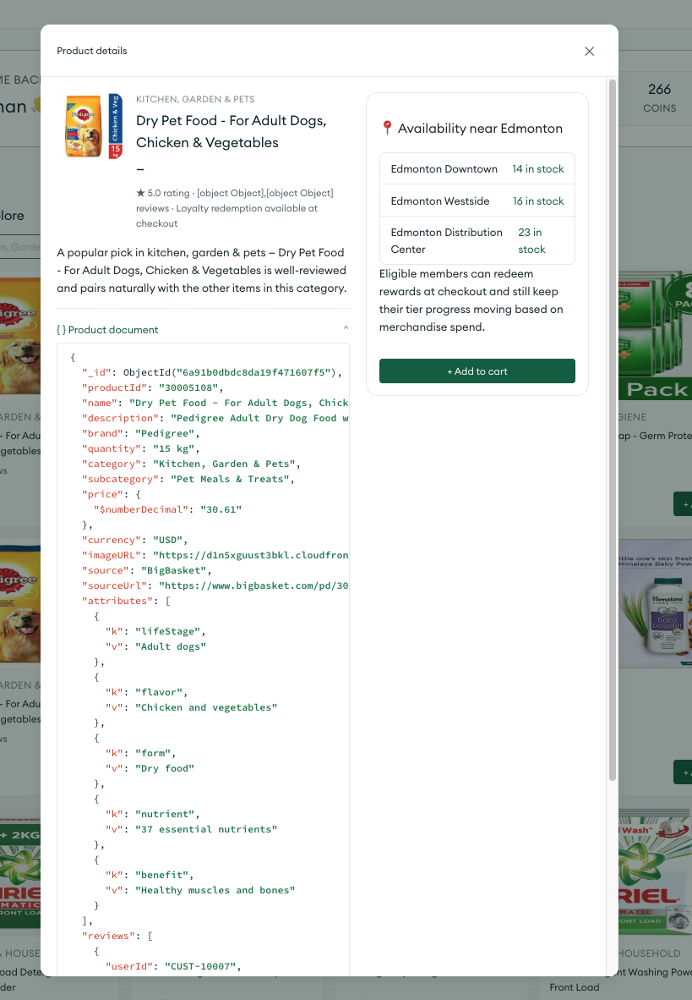

5. Click **+ Add** on a few products. The cart icon in the header updates; open the cart to move to the next page.

   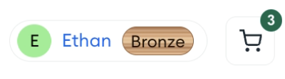

---

## **2. Cart Page**

1. Review the items in **My Cart** and the **Order Summary** on the right.
2. Point to the yellow message under the totals: it tells the shopper how many coins this order will earn at the active campaign multiplier—**before they commit to anything**. The estimate recalculates as the cart changes, using the same loyalty rules applied when the order is actually placed. Note: coins are earned **only on the subtotal**, not on taxes or shipping.

   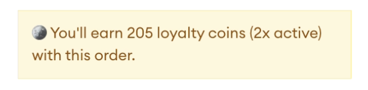

3. Click **"Proceed to checkout."**

   

> The coin estimate is a preview—nothing is recorded in MongoDB until the order is placed.

---

## **3. Checkout Page**

1. Review the prefilled **Shipping information** and **Payment details** (from the customer record), then expand the items in the **Order Summary**.

   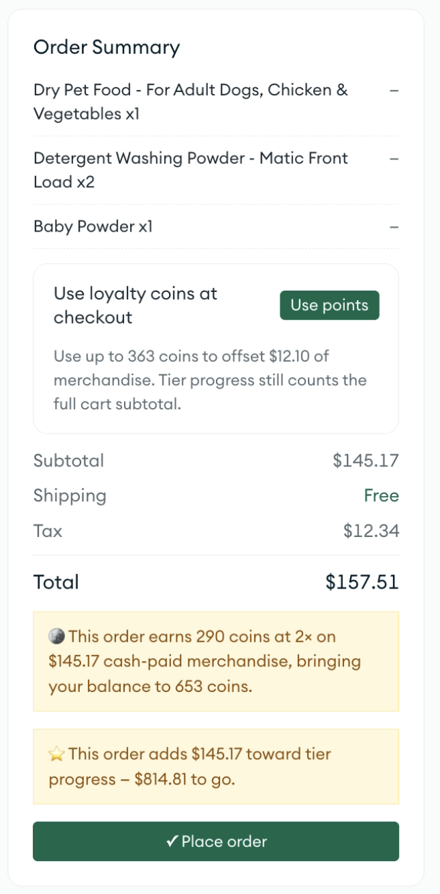

2. Before applying any coins, read the two yellow messages near **Place order**: one explains the coins this order earns, the other the progress it adds toward the next tier.

   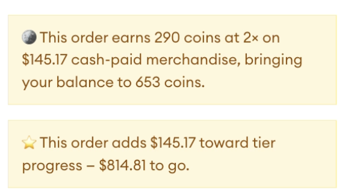

3. In the **"Use loyalty coins at checkout"** box, click **Use points** and drag the slider. A **Coins applied** line appears in the summary and the total drops—coins give a discount on the merchandise subtotal.

   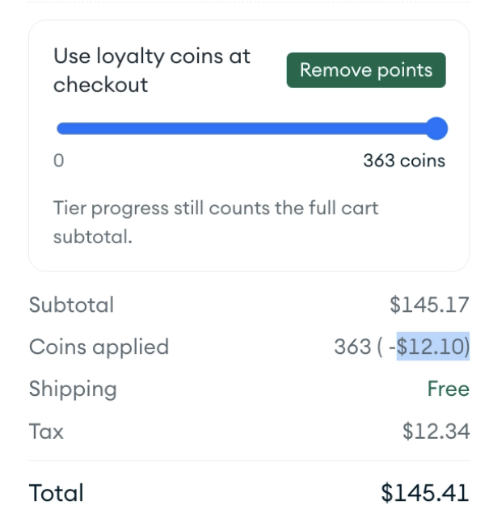

4. Watch the two yellow messages update. Coins are earned on the portion paid in cash, so using coins changes what the order earns and what it adds toward tier progress.

   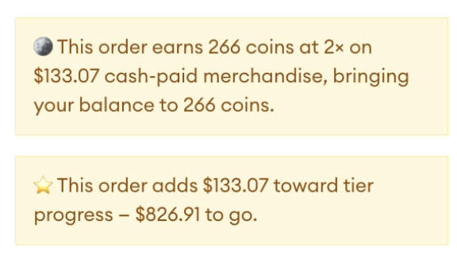

5. *Optional:* open **Admin** to show the **Loyalty Settings** backoffice. Walk through **Reward value**, **Tier thresholds**, and **Promo campaign** tabs—the rules behind these numbers are data an admin can edit, not code.

   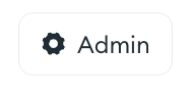

6. *Optional:* click **"Use invalid card"** to simulate a declined payment. The failed payment is recorded but awards or redeems no coins.

   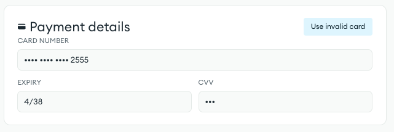

7. Switch back to a valid card and click **Place order**.

> 💡 To explain the math without doing it live: *coins applied* reduce the subtotal, and the multiplier is applied to what is left to pay in cash. Higher tiers make each coin worth more at redemption—that's why reward value is defined per tier in Admin.

---

## **4. Order Confirmation Page**

1. The **Order Confirmed** page shows the order number and a status tracker (the order moves through its stages on its own for demo purposes).

   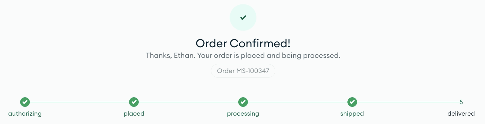

2. Point to the **Loyalty rewards earned** card: coins earned, the active multiplier, the tier badge, the progress bar, and the summary sentence. **The reward landed the moment the order was placed.**

   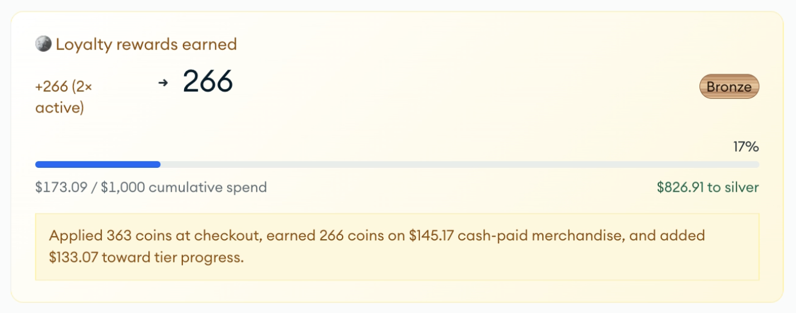

3. Scroll to **Items ordered** and highlight the loyalty lines in the breakdown: **Coins applied at checkout**, **Coins earned**, and **Tier qualifying spend**.

   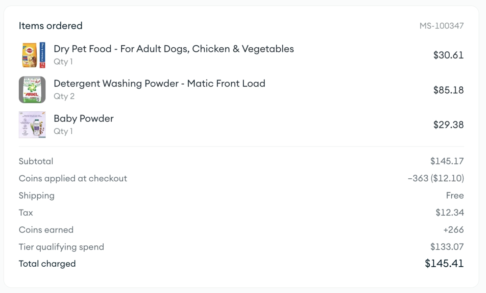

4. Walk down the **Behind the scenes** panel. Click on every "Learn More" button to see the behind the scenes of each step. The **MongoDB transaction** badges mark the two writes—the loyalty history and the customer update—that succeed or fail together.

   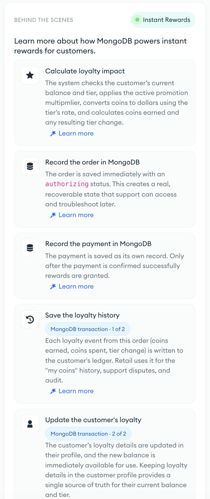

5. Click **Learn more** on a step to open its modal. Use the tabs (e.g., **Loyalty as data**, **Document Model**) to show the loyalty configuration and the payment record as real MongoDB documents.

   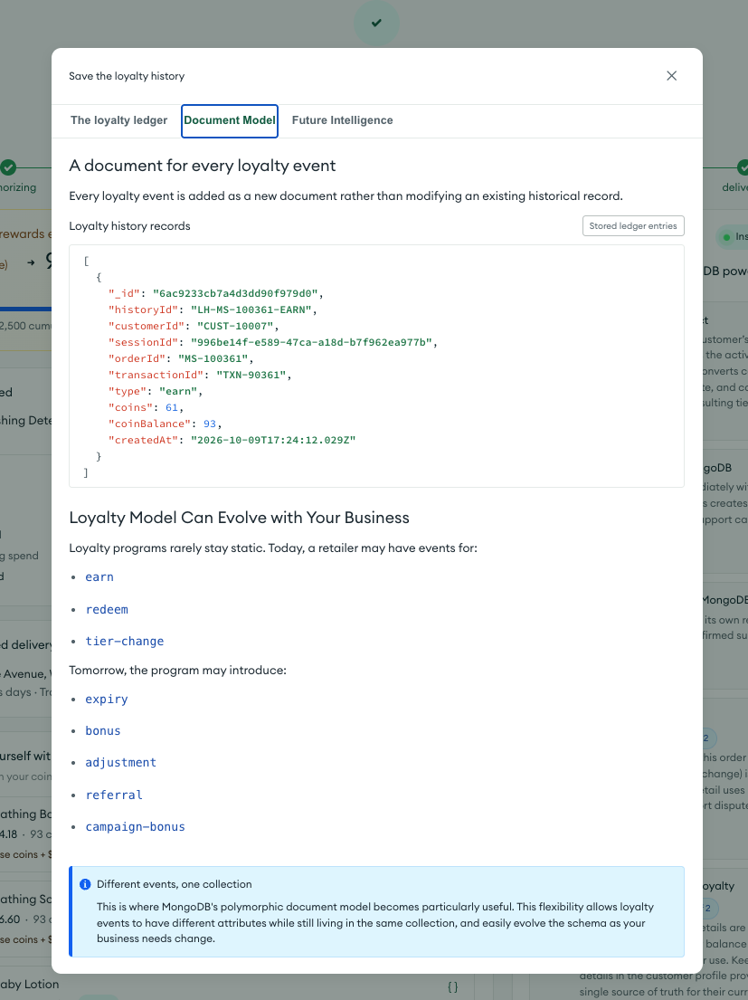

6. Scroll to **"Treat yourself with the coins you've earned."** Each suggestion is tagged **Coins only** or **Hybrid**, depending on whether the fresh balance covers it fully. Click **Redeem now** → **Confirm redemption** to spend the just-earned coins immediately—or continue to the next page.

> 💡 The last step in the panel, *Refresh the customer profile across channels*, is the **change stream** story: updates are pushed to the app when loyalty data changes—no polling, no separate message broker.

---

## **5. Order History Page** (`Orders` in the navbar)

1. Point to the three summary cards: **Orders on file**, **Completed**, and **Reward position** (coin balance and tier rate).

   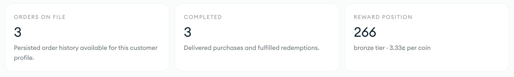

2. Scan the order list: each row shows order number, date, channel, delivery status, and the loyalty effect (coins applied or earned).

   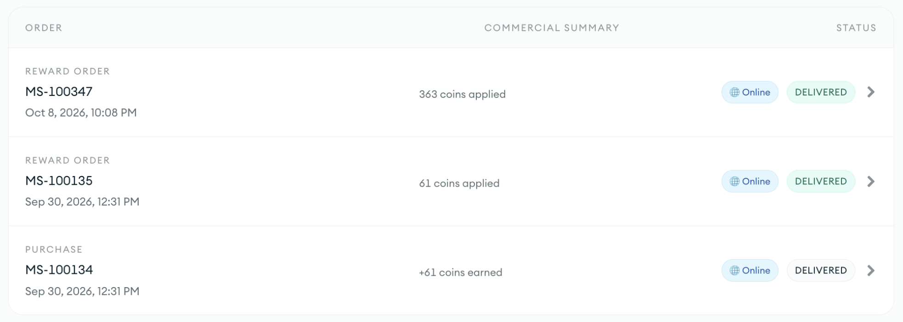

3. Click an order to open its detail with the full breakdown, including coins applied and earned.

   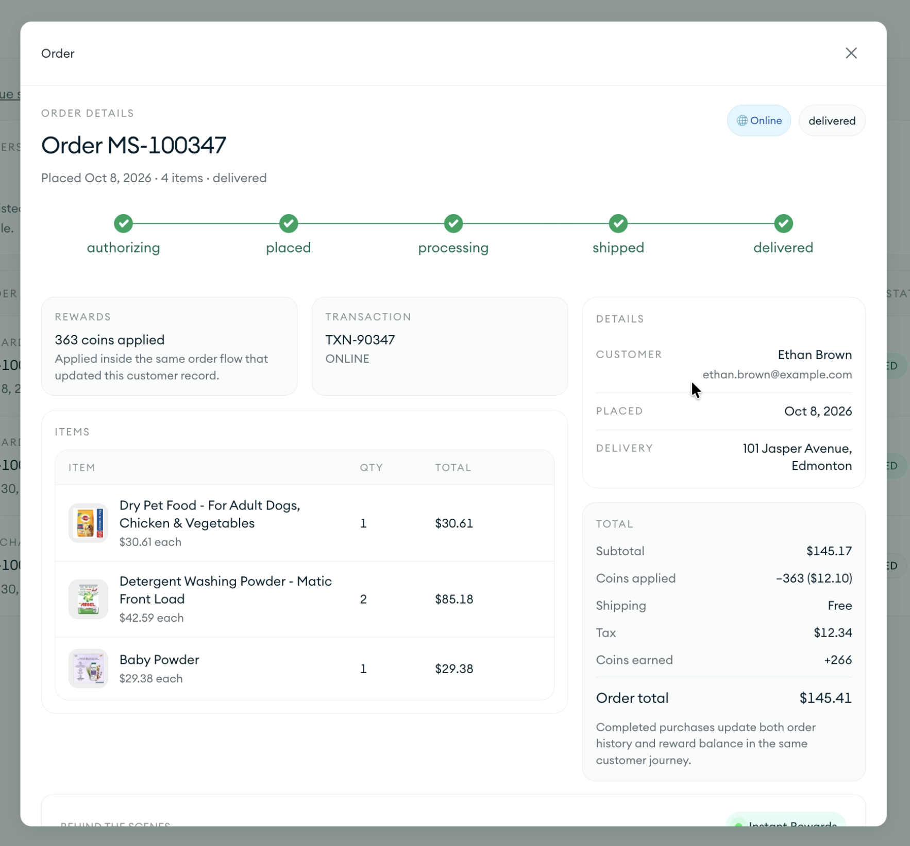

4. Scroll inside the detail to **Behind the scenes** and expand a step to reuse the explanations from the confirmation page.

   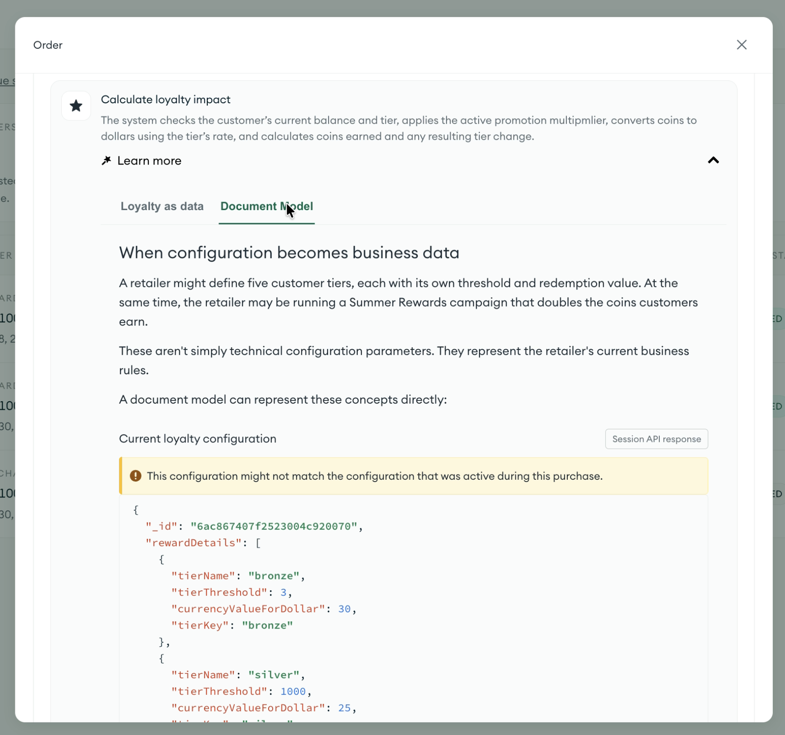

---

## **6. Loyalty History Page** (`Coin history` in the navbar)

1. Point to the header card: the member's name, tier, coin value at that tier, current **coin balance**, and progress toward the next tier.

   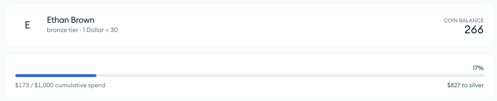

2. Scroll to **Transaction history**. Newest events are at the top: the **Redeemed** and **Earned** entries from the order just placed are already there—no manual refresh, no batch job.

   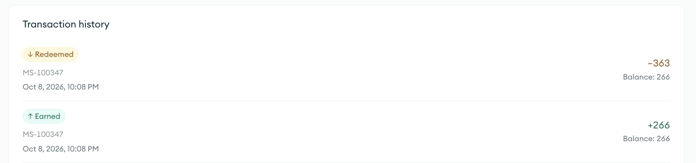

3. Pick one entry and show its order reference, date, amount, and **Balance after**—each balance is the result of the entry before it, so the balance can always be explained.
4. Scroll down to the older history to find a **Tier upgraded** entry showing a tier change in the same timeline.

   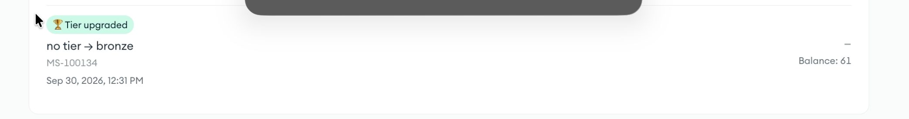

> For support teams, this is the screen that answers "where are my coins?" with a clear, ordered record that always matches the balance on the customer document.

---

## **7. Profile Page**

1. At the top, point to the member's tier and progress, then to **Personal details**, **Payment method**, and **Delivery address**.

   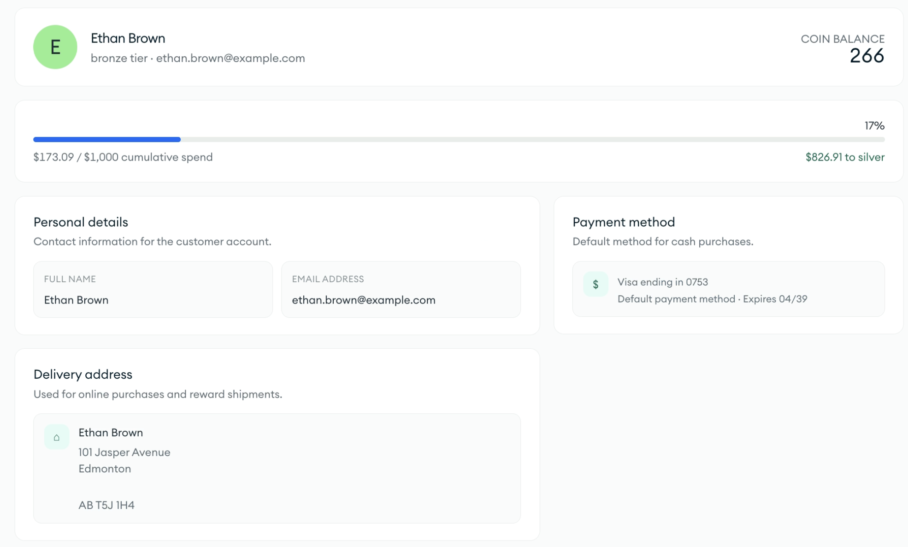

2. Scroll to **Tier benefits** and walk through the tiers, showing how the member's current tier is marked.

   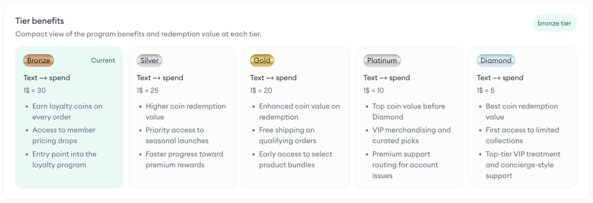

3. Scroll to **Your data** and click **See document**. In the **User Schema** modal, scroll to `loyaltyDetails`: active tier, next tier, coin balance, and cumulative spend—**all inside the same document** as the profile and addresses.

   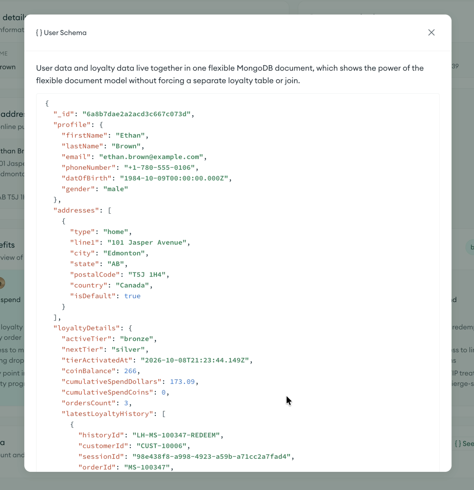

> The flexibility of the Doc Model: the member's identity, preferences, and loyalty state are **one document**—no separate loyalty table, no join. Every screen reads from this same document, so a change made at checkout shows up everywhere without extra synchronization.

---

## **8. End the Session**

Use **Logout** in the header to end the demo session. This releases the persona for the next presenter and triggers the cleanup of session-specific demo data (see the [Collections Setup Guide](../../../setup/collections/README.md) for how the Atlas Triggers keep demo data clean).

---

# 🎬 What Happens When an Order Is Placed (Behind the Scenes)

The **Behind the scenes** panel (confirmation page and Talk track modal) walks through six steps:

1. **Calculate the loyalty impact** – three small reads (customer, loyalty configuration, products), no joins; rules come from a document, not code.
2. **Record the order** – one order is one document, so a single insert is already atomic; loyalty fields sit next to the commerce fields.
3. **Record the payment** – each payment method is one entry in a tenders array; a declined payment is stored as data, with no coins awarded.
4. **Save loyalty changes to history** – every coin earned or spent is appended to the ledger; entry IDs are derived from the order ID, so retries can't duplicate.
5. **Update the customer's loyalty** – balance, cumulative spend, and tier update **in the same MongoDB transaction as step 4**: both commit, or neither does.
6. **Refresh the app automatically** – a **change stream** on the customer document pushes only committed changes to the app: the header balance updates, and a tier-up triggers a celebration.

---

# ℹ️ Notes

- The payment gateway is **simulated**; the "Use invalid card" toggle exists to demo the declined-payment path.
- The order status tracker advances on its own for demo pacing.
- Switching the active campaign in **Admin** changes the coin estimate the next time the cart is calculated—use this to show *dynamic* loyalty: rules change in real time, with no release.
- Sessions left open are automatically closed after 8 hours by a scheduled Atlas Trigger (demo housekeeping; see the [Collections Setup Guide](../../../setup/collections/README.md)).
